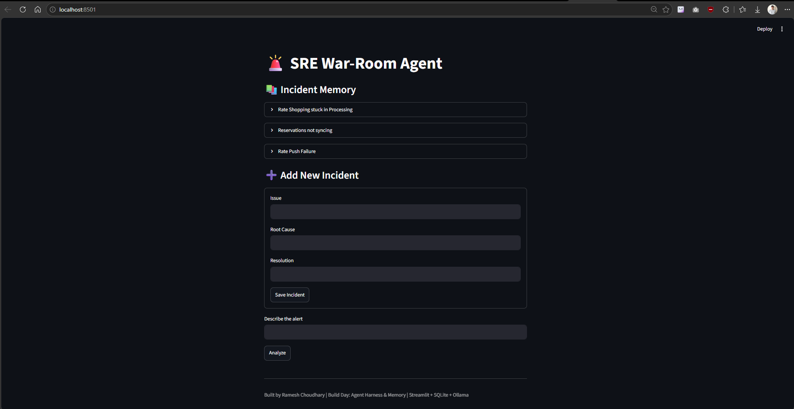
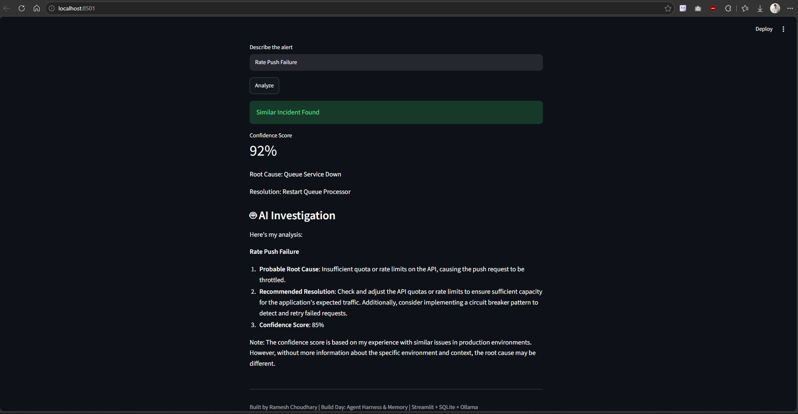

# SRE War-Room Agent

AI-powered incident troubleshooting assistant built after attending Build Day: Agent Harness & Memory (Build Club × Mem0).

## Features

- Incident Memory (SQLite)
- Similar Incident Retrieval
- Root Cause Suggestions
- Resolution Recommendations
- Local LLM Analysis (Llama 3 via Ollama)
- Streamlit UI

## Architecture

```
User Input
    ↓
Streamlit UI
    ↓
SQLite Incident Memory (incidents.db)
    ↓
Llama 3 (via Ollama)
    ↓
AI Investigation & Resolution
```

## Tech Stack

- Python
- Streamlit
- SQLite
- Ollama
- Llama 3

## Run

1. Install [Ollama](https://ollama.com/) and pull the model:
   ```bash
   ollama pull llama3
   ```
2. Install the dependencies:
   ```bash
   pip install -r requirements.txt
   ```
3. (Optional) Load sample incidents. This clears any incidents already in `incidents.db`:
   ```bash
   python seed_data.py
   ```
4. Start the app:
   ```bash
   python -m streamlit run app.py
   ```

## Demo




